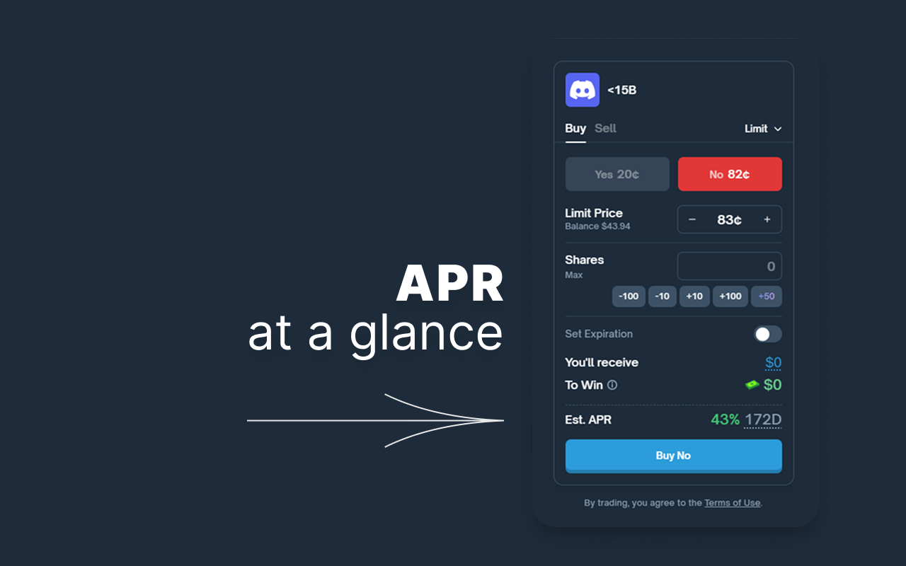
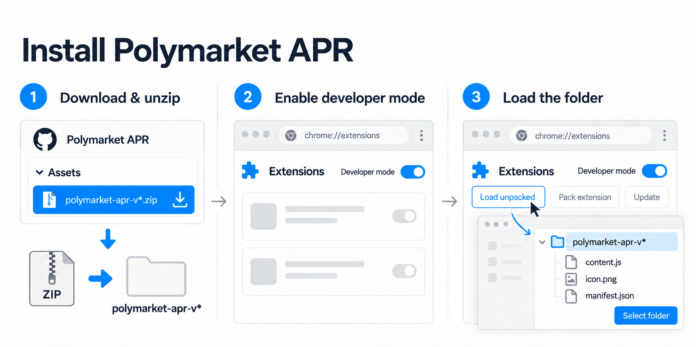

# Polymarket APR

Chrome extension that adds a native-style APR (Annual Percentage Rate) block to the Polymarket trade widget.

## Preview

## Install

**The latest version is always on [GitHub](https://github.com/DennisLypovetsky/polymarket-apr/releases/latest).** The [Chrome Web Store](https://chromewebstore.google.com/detail/polymarket-apr/dainflhaaolcjggcopmjhpaodnleicib) is behind and currently stuck at **v1.2.9**.

### Install the latest release in Chrome

1. [Download the latest release](https://github.com/DennisLypovetsky/polymarket-apr/releases/latest) → **Assets** → `polymarket-apr-v*.zip`. Unzip it.
2. Open `chrome://extensions` → turn on **Developer mode**.
3. Click **Load unpacked** → select the unzipped folder.

Keep the folder, disable any older copy, and reload Polymarket.

## Repository Structure

- `polymarket-apr/` - extension source used for development and testing
- `releases/` - release metadata/docs + one current local ZIP artifact (ZIP binaries are not committed)
- `pictures/` - icons, screenshots, and promo assets

## Development Workflow

See [CONTRIBUTING.md](CONTRIBUTING.md) for the full development, branching, versioning, and release flow.
